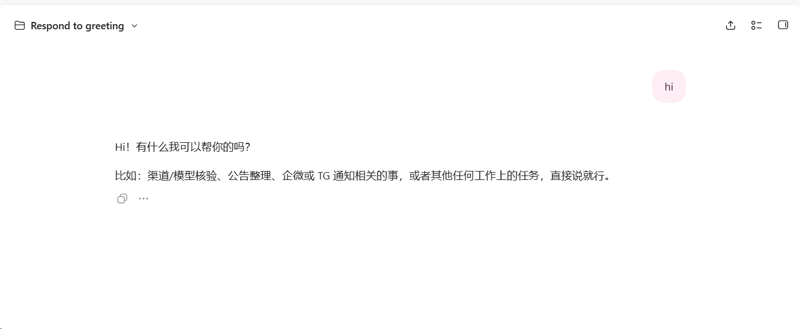
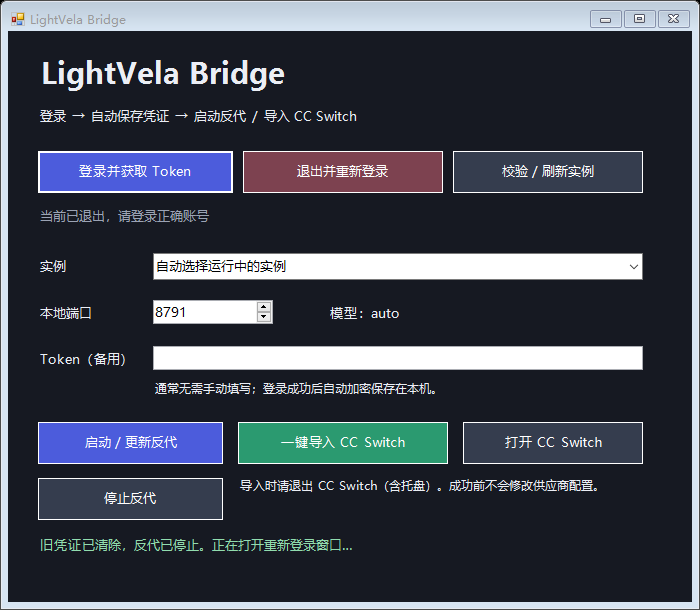

# LightVela Bridge

把自己的 LightVela 账号接入 DSH，或通过本地桌面工具接入 CC Switch / Codex。

本仓库包含两种独立使用方式，**不需要同时安装**，也不包含 DSH、CC Switch 或 Codex 本体。

| 你要用在哪里 | 使用哪个目录 | 是否需要另一组件 |
|---|---|---|
| DSH 的模型列表和设置页 | [`dsh-connect-lightvela`](./dsh-connect-lightvela/) | 不需要桌面反代 |
| CC Switch / Codex / OpenAI 兼容客户端 | [`lightvela-proxy`](./lightvela-proxy/) | 不需要 DSH 插件 |

这是社区工具，与 LightVela、DSH、CC Switch 和 OpenAI 官方无关联。使用自己有权限的账号和实例；可用模型、接口及费用以对应服务为准。

## 效果展示

用户提供的 Codex 成功回复截图。它展示文本回复链路，不代表完整的 Codex 原生工具调用兼容性。



桌面工具的隔离测试界面（模拟数据）：



## Windows 桌面工具

功能包括网页登录后自动获取 Token、使用 Windows 当前用户加密保存、退出并重新登录、更换账号、实例检查、启动本地反代，以及备份后导入 CC Switch。

准备 Node.js 24 或更新版本、Windows PowerShell 5.1 和 Microsoft Edge WebView2 Runtime。在 `lightvela-proxy` 目录运行：

```powershell
.\Restore-WebView2.ps1
.\Build-Desktop.ps1
.\LightVela-Bridge.exe
```

恢复脚本只下载微软官方 WebView2 SDK，并核对固定 SHA256；不包含登录资料。若本机策略禁止脚本执行，请使用你认可的本机脚本运行方式。

1. 点「登录并获取 Token」，完成官方网页登录；需要账号下有正在运行的实例。
2. 如果选错账号，点「退出并重新登录」，选择正确账号。取消重新登录后保持退出，端口会保留。
3. 点「启动 / 更新反代」，保持工具运行。
4. 在客户端填写下面的配置；也可以完全退出 CC Switch（含托盘）后点「一键导入 CC Switch」。导入会备份数据库并把 LightVela 设为当前 Codex 供应商。

| 配置 | 默认值 |
|---|---|
| Base URL | `http://127.0.0.1:8790/v1` |
| API Key | `local-lightvela`（本地占位值） |
| Model | `auto` |
| 协议 | Codex 用 Responses；普通兼容客户端用 Chat Completions |

端口改动后，客户端地址也应同步。这里的 API Key 是占位值；真正的 LightVela Token 由桌面工具保存，不要填到公开示例里。

详细说明见 [桌面与代理说明](./lightvela-proxy/README.md)。

## DSH 插件

适合已经使用 DSH 的用户：增加 LightVela 模型入口和设置面板，可以登录、查看实例状态、切换网关 / Agent 通道。

插件需要 DSH 提供 `@deepseek-ai/dsh-llm` 和 `@deepseek-ai/schemastery`。本仓库没有打包 DSH 主程序、个人 profile 或其他插件。安装和配置见 [DSH 插件说明](./dsh-connect-lightvela/README.md)。

两组件的凭证存储互相独立。桌面工具自动登录不会自动替 DSH 插件登录。

## 验证与边界

- 代理提供 `/v1/models`、`/v1/chat/completions`、`/v1/responses`，支持文本输出及 SSE 事件。
- 代理通过账号实例执行 Hermes；当前实现会先取得完整回复，再分段发送 SSE，并非模型原生逐 Token 透传。
- 代理把上下文压成文本；尚未实现完整的 Codex 工具调用、图片输入和 Responses 会话状态能力。简单对话成功不等于完整编程工作流通过。
- DSH 网关分支包含工具定义转发和工具调用解析；具体能力依赖所选上游模型。Agent 分支有实例自身的执行能力，但不等同于 DSH 的原生工具协议。
- `usage` 为字符数估算，不能用于费用核对。真实调用可能消耗 LightVela 积分。

本次公开整理只运行本地模拟测试和隔离登录清理测试，没有自动发送真实模型请求。截图由用户提供，不作为每个功能的验收证据。

```powershell
cd lightvela-proxy
node --test tests/*.test.mjs
# Windows：先恢复 WebView2 SDK，再检查隔离登录清理
powershell.exe -NoProfile -STA -File tests\desktop-logout.ps1
```

`verify*.mjs`、`test-live.mjs`、`smoke.mjs` 是手动实测脚本，默认拒绝运行，需要显式设置 `LV_ALLOW_LIVE_TESTS=1`；部分脚本会消耗积分。不要向它们传入命令行形式的 Token。

## 隐私与源码范围

公开版从指定源码文件重新整理，不携带原工作区 Git 历史。仅包含组件代码、构建与验证脚本、通用说明及演示图片；不包含登录状态、浏览器配置、实际数据库、账单、私有排障记录或其他工作项目。

请阅读 [隐私与凭证说明](./PRIVACY.md)。本项目尚未指定项目许可证；第三方依赖适用各自许可证，WebView2 的许可和 NOTICE 保留于 `lightvela-proxy/vendor/webview2`。
